<div align="center">






### 🐾 whoami

</div>

```kotlin
object Mochiiwuff {
    val vibe     = "furry dev 🐾"
    val stack    = listOf("Kotlin", "Python", "JS/React", "C++", "Rust", "Go")
    val building = listOf("am-music", "am-music-desktop", "ytgrab")
    val motto    = "if the app doesn't exist, I build it"
}
```

<div align="center">


### 🛠️ stack


### 📂 projects

<a href="https://github.com/mochiiwuff/am-music"></a>
<a href="https://github.com/mochiiwuff/am-music-desktop"></a>
<a href="https://github.com/mochiiwuff/ytgrab"></a>


### 📊 stats


</div>
